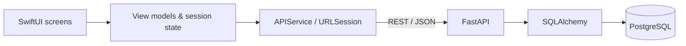

# MoveMates

### An iOS sports community application

**MoveMates** is a native iOS application designed to help people discover sports activities, meet other players, and organise games together. Built as a university iOS development project, it brings together mobile application development, backend engineering, and an original visual identity.

The project covers the application experience from onboarding and player profiles to event management, join requests, messaging, and ratings. I designed the MoveMates branding and user interface and developed the iOS app and supporting REST API.

## Highlights

- **Discover activities:** Browse sports events and search for games by their details.
- **Create an event:** Choose a sport, location, date, time, number of players, skill level, and participation preferences.
- **Manage participation:** Request to join events and review or approve incoming requests as an organiser.
- **Connect with players:** View profiles and exchange private messages.
- **Build a community:** Leave ratings and feedback for other players.
- **Personalise the experience:** Create an account, set up a profile, and manage profile information.

## Technology stack

| Layer | Technologies | Purpose |
| --- | --- | --- |
| iOS application | Swift, SwiftUI | Native screens, navigation, forms, and reusable interface components |
| Application architecture | Observable view models, shared session state | Separates interface state from application and networking logic |
| Networking | `URLSession`, REST/JSON | Communication between the iOS client and backend |
| Backend | Python, FastAPI | HTTP endpoints for users, games, participation, and messages |
| Data access | SQLAlchemy | Database models, sessions, and persistence |
| Database | PostgreSQL | Storage for application data |
| Device integration | Core Location, photo selection | Location-assisted event creation and profile imagery |

## System architecture



The iOS client handles presentation, navigation, and user interactions. A dedicated service layer sends HTTP requests to the Python backend, which provides routes for the main community features and persists data through SQLAlchemy.

### Application organisation

The Swift source is grouped into:

- `Views/` for screens and interface components.
- `ViewModels/` for feature-specific state and operations.
- `Models/` for application data structures.
- `Services/` for backend API communication.
- `HelpersComponents/` for shared utilities, session management, and device-related functionality.

The backend is divided into API routers for `users`, `games`, `participants`, and `private_messages`, alongside database models and request/response schemas.

## Key engineering work

### 1. End-to-end event flow

Implemented the flow from creating and discovering sports events to requesting participation and approving join requests. Event creation includes structured inputs for the sport, location, scheduling, player capacity, and preferences.

### 2. Native mobile experience

Built the interface in SwiftUI with onboarding, authentication, profile setup and editing, event screens, messaging, and navigation. The app uses state-driven screen transitions and feature-specific view models.

### 3. Client–server integration

Connected the iOS application to a FastAPI backend using asynchronous HTTP requests and JSON data models. Backend routes handle core application operations and interact with a relational database through SQLAlchemy.

### 4. Original product design

Created the MoveMates visual identity, including its logo, dark interface palette, navigation patterns, and individual screen layouts. This was both a software development project and an opportunity to design a coherent product experience.

## Repository structure

```text
MoveMates/
├── MoveMates/               # SwiftUI iOS application
│   ├── Assets.xcassets/
│   ├── HelpersComponents/
│   ├── Models/
│   ├── Services/
│   ├── ViewModels/
│   └── Views/
├── MoveMates.xcodeproj/     # Xcode project
├── movemates_backend/       # Python FastAPI backend
│   └── routes/
├── .gitignore
└── README.md
```

## Project scope

MoveMates was developed as an **academic application project**. The repository is intended to document the implementation and design, not to represent a production-deployed service or an App Store release.

Running the complete application requires a configured backend, a PostgreSQL database, and an iOS development environment. Local credentials, user-uploaded images, generated files, and other private development data are not part of the public project.

## Author

**Mazen Younis**  
Software Developer | Embedded Systems | Industry 4.0 | AI & RAG Systems

[GitHub](https://github.com/Mazen-younis) · [Portfolio](https://mazen-younis.github.io)
